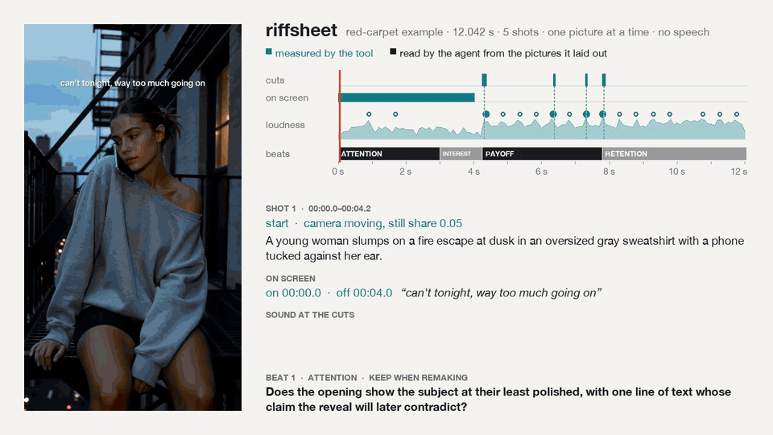
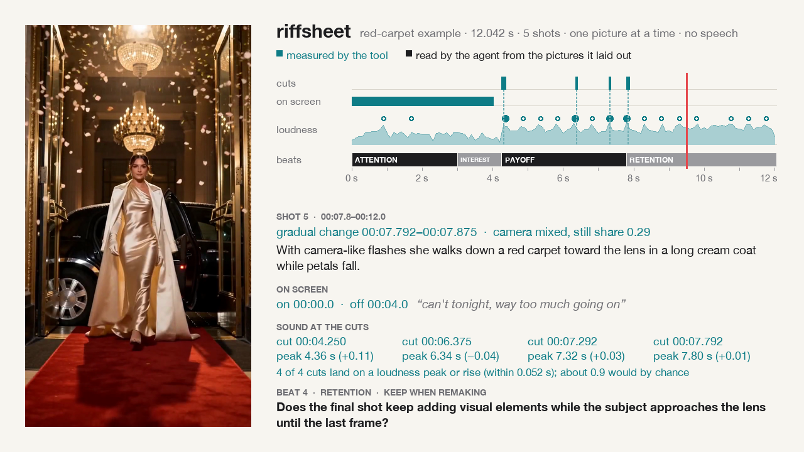
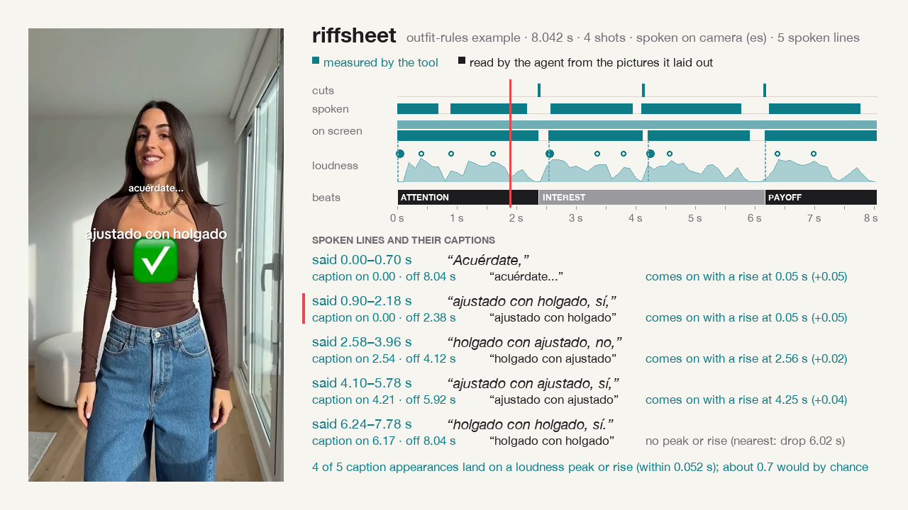
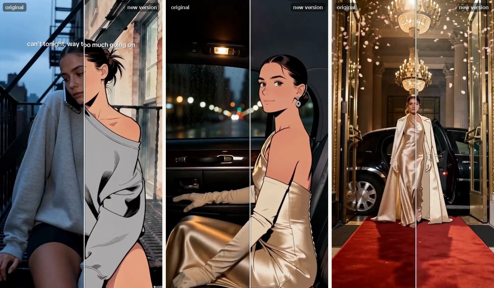
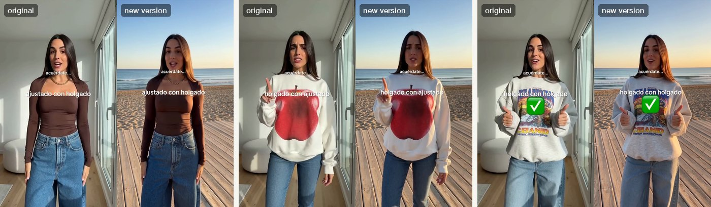
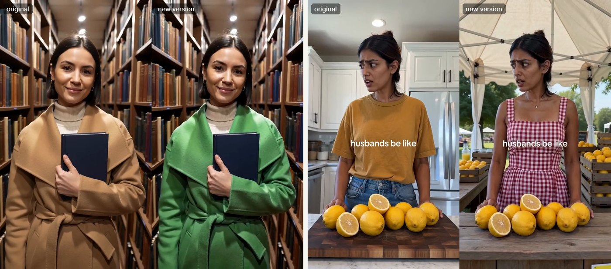

<h1 align="center">riffsheet</h1>

<p align="center"><b>Video breakdown for coding agents: your agent analyzes a short video shot by shot, on your own machine.</b><br>
Cut times, caption on and off times, loudness and word times are measured; the agent reads laid-out pictures for the rest.<br>
You get a riffsheet: what happens, why it holds a viewer, and what your own version has to keep.</p>

<p align="center">
<a href="#install">Install</a> · <a href="#examples">Examples</a> · <a href="EVAL.md">How accurate it is</a> · <a href="#what-it-cannot-do">Limits</a> · <a href="README.zh-CN.md">简体中文</a>
</p>

<p align="center">Free, MIT, runs offline with Python and ffmpeg. An agent skill for Claude Code, Codex and other agents that can run commands and read images.<br>
<sub>Made by <a href="https://riffkit.ai/?utm_source=riffsheet&utm_medium=github&utm_campaign=riffsheet&utm_content=readme_maker">Riffkit</a>. riffsheet needs no account and sends nothing to us.</sub></p>

<p align="center"><picture><source media="(prefers-reduced-motion: reduce)" srcset="docs/media/hero_still.png"></picture></p>
<p align="center"><sub>A video of ours, broken down by riffsheet. Full result in <a href="examples/red-carpet/">examples/red-carpet</a>.</sub></p>

## Install

You need ffmpeg 7 or newer and Python 3.9 or newer. Spoken words need the optional `faster-whisper` package (see [Requirements](#requirements)).

**1. Tell your agent** (Claude Code, Codex, or any agent that runs commands):

```text
Install the riffsheet skill from https://github.com/riffkit/riffsheet, then break down ~/Downloads/clip.mp4
```

**2. Or put it in your agent's skills folder with git:**

```bash
git clone https://github.com/riffkit/riffsheet ~/.claude/skills/riffsheet   # Claude Code
git clone https://github.com/riffkit/riffsheet ~/.agents/skills/riffsheet   # Codex
```

In Claude Code you can also add it as a plugin: `claude plugin marketplace add riffkit/riffsheet`, then `claude plugin install riffsheet@riffsheet`. Other agents: put the folder anywhere and say "Read SKILL.md in the riffsheet folder and follow it."

**3. Or with the skills command line tool** (needs Node): `npx skills add riffkit/riffsheet`

## Try it

Give your agent a video file and ask in your own words:

```text
Break down this video shot by shot: ~/Downloads/ad.mp4
Why does this TikTok work? I want to make my own version.
Analyze this Reel and list every caption with its timing.
```

About 4 to 8 minutes later you have `riffsheet.md` to read and `riffsheet.json` with every value. This is the start of one from the examples, an 8-second video spoken in Spanish:

> **8.042 s · 4 shots · one picture at a time · spoken on camera (es) · 5 spoken lines**
>
> Sound and picture (measured times, not what the sound is): 0 of 3 cuts land on a loudness peak or rise (within 0.052 s); about 0.4 would by chance, with 11 peaks and rises in 8.0 s; 4 of 5 caption appearances land on a loudness peak or rise (within 0.052 s); about 0.7 would by chance, with 11 peaks and rises in 8.0 s.
>
> **00:02.4–00:04.1** At 00:02.375 a hard cut (checked on frames: no motion blur, nothing covering the lens, no blended, faded or white frame between) changes her clothes while the static, locked eye-level medium-wide framing and the place hold … She now wears an oversized white crew-neck sweatshirt printed with one large photographic red apple across the front over mid-blue skinny jeans. … The main person says on camera at a measured pace, frowning with the finger raised, “holgado con ajustado, no,”.
>
> **Keep when remaking.** Does each outfit change at a cut together with its rule label, and does at least one verdict break the run of approvals with a visibly different reaction?

## Examples

Two first runs by coding agents that had never seen the project, on videos of ours, each with the pictures the agent worked from, the commands it ran and what it was unsure of. Nothing the agents wrote was edited.

| | |
|---|---|
| <a href="examples/red-carpet/"></a> | <a href="examples/outfit-rules/"></a> |
| **[red-carpet](examples/red-carpet/)**: 12 s, edited to music, nobody speaks. Speech recognition heard a phrase in the music; the agent checked her mouth frame by frame and wrote no spoken lines. The tool counts 4 changes as cuts (a fade, a hard cut and two flash frames), and all 4 land on a loudness peak or rise, against about 0.9 by chance. | **[outfit-rules](examples/outfit-rules/)**: 8 s, Spanish spoken to camera, captions. 4 shots, 5 spoken lines. 0 of 3 cuts land on a loudness peak or rise, but 4 of 5 caption appearances do. |

## What you get

Two files per video:

- `riffsheet.md`, an account of the video for a person to read: what happens, why it holds a viewer, and then each beat in order, with what is on screen, what is said, what the beat does for the viewer and what a remake has to keep.
- `riffsheet.json`, the complete data: every spoken line with its time and pace, every caption with its words, times, position, size and colors, every graphic with its box and times, the people and objects, a time-coded description of each segment, where sound events fall on the cuts and caption appearances, and where each value came from. The format is in [`schema/riffsheet.schema.json`](schema/riffsheet.schema.json).

The line quoted above, in `riffsheet.json`, with the agent's correction of a misheard word:

```json
{"id": "vs3", "time_range": [2.58, 3.96], "text": "holgado con ajustado, no,",
 "mode": "on_camera_dialogue", "speaker": "protagonist",
 "_src": {"time_range": "measured", "text": "measured"},
 "_pace": {"unit": "words", "count": 4, "per_s": 2.9, "band": "measured", "longest_gap_s": 0.14,
           "pauses_over_0_4s": [], "trend": null},
 "_notes": ["transcript 'olvado' -> 'holgado' (seen in a word-for-word caption)"]}
```

## How it keeps to what is on screen

- **Measured where a measurement is possible.** Cut times, the frame on which each caption appears and the frame on which it is gone, and whether the camera holds still are measured from the frames; loudness, the time of each spoken word and the pace of each line, from the sound.
- **Every value says where it came from:** measured by the tool, seen by the agent, inferred, uncertain, or not judged. Where the evidence does not settle a measurement, the tool leaves the value out and says why.
- **Every detail points to a close view of its moment.** A statement about what people wear and hold, a product or the place has to name a large view of a moment it describes, or be marked uncertain; until then the tool writes no riffsheet. The tool checks that the view exists and shows that moment; matching the words to it is the agent's work.
- **It says what it could not judge.** Tone of voice, what kind of music plays and anything else the pictures and measurements do not settle are listed as not judged.
- **Nothing to install but ffmpeg.** Plain Python, standard library only. No model download is needed; speech recognition is optional.
- **It explains why the video works.** Beat by beat, what each part does for the viewer, and one test a remake has to pass to keep it.

The procedure the agent follows is [`references/METHOD.md`](references/METHOD.md); each command is described in [`references/TOOL.md`](references/TOOL.md).

## How accurate it is

Two tests, run on 2026-11-27 on development builds made before this release (details and method in [EVAL.md](EVAL.md)):

| measure | result |
|---|---|
| statements on ten videos (8 to 45 s; English, Chinese, Korean), each checked against the frames by a separate agent | 649 correct, 23 wrong, 17 missed |
| hard cuts, six videos checked for cuts | 24 of 25 found, no false cut |
| caption on and off times, two videos with frame-by-frame ground truth | exact to the frame |
| a 10.6 s video that played no part in development, scored against 137 facts listed from its frames beforehand | 64 stated exactly, 36 partly, none contradicted |

Measured again on the code in this release: the cut finder still finds 24 of the 25 hard cuts on those six videos, with no false cut; on a 45-second talking video with 9 jump cuts inside one framing it finds 7. The statement counts were not measured again. The checking agents are the same kind of model as the one writing, sound was not scored, and ten videos is a small sample.

## What it cannot do

- **Hear.** It measures loudness, word times, and where sound events fall on the cuts and caption appearances, but not what a sound is: music, tone of voice and sound effects are marked as not judged. Speech recognition can return words where nobody speaks; the agent checks the mouth and sets them aside (the red-carpet example).
- **Read text by itself.** The tool finds captions and when they change; the agent reads the words from the pictures. Where a caption's style cannot be measured, the agent gives its own reading and says so.
- **Catch every edit.** A jump cut inside one framing is found when a tenth of the picture or more changes in one frame and keeps its colors: 7 of 9 on a 45-second talking video. Smaller jumps are flagged for the agent or not found; a different outfit, person or object faded in over the same background is not detected; a slow dissolve can be missed. [`references/TOOL.md`](references/TOOL.md) lists every known limit.
- **Handle long videos well.** It is made for clips up to about a minute and was tested on clips of 8 to 45 seconds. A longer video runs with its overview pictures spaced further apart, and past three minutes the tool warns what will be slow.
- **Fetch videos from a link.** Give it the file.

## Time and cost

The tool's own work takes seconds for a short clip. Most of the time is the agent's: five first runs on this release (8 to 45 seconds, the two examples among them) each finished without help in about 4 to 8 minutes, with about 40 commands and 20 images opened for the examples. They were not scored statement by statement. The cost in agent usage comes mostly from the images it opens and the number of steps, so the procedure batches them, and the tool prints each image's size and estimated token cost.

## From the sheet to your own version

A riffsheet tells you what each beat does and what your version has to keep. Captions, cards, graphics, timing and the edit can be rebuilt with code (ffmpeg, a script) or in a video editor, from the measured times, boxes and colors. Footage of people, places and products cannot: it needs a camera or a video model.

[Riffkit](https://riffkit.ai/?utm_source=riffsheet&utm_medium=github&utm_campaign=riffsheet&utm_content=readme_footage) makes that footage from your original video, with a free start. Swap keeps the shots and changes who or what is in them; Adapt keeps what made the video work and tells a new story. Riffkit's own skill tells an agent how to use a riffsheet with it.

The two examples, remade with Swap:

| | |
|---|---|
|  |  |
| [red-carpet](examples/red-carpet/) as hand-drawn animation. We have this version only as a comparison picture and make no measured claim about it. | [outfit-rules](examples/outfit-rules/) on a beach boardwalk. Measured with riffsheet: 2 of 3 cuts and 7 of 10 caption on and off times fall on the same frame as the original's, the rest within two frames ([table](examples/outfit-rules/#from-the-sheet-to-your-own-version)). |

Other things Swap changes, such as a coat's color, or the outfit and the place together:

<p align="center"></p>

## Privacy

Everything runs on your machine: the video, the pictures and the results stay in the folders you choose. The only network use is the speech-model download, and only when you ask for it with `--download`. What your coding agent sends to its own model provider is governed by that agent.

## Questions

**Does it work offline?** Yes. After the optional speech-model download, nothing uses the network.

**Which agents does it work with?** Any agent that can run shell commands and open images: Claude Code and Codex find it as a skill; others can be told to read `SKILL.md`.

**Can it take a link?** No. Download the video yourself and give the agent the file.

**Can I use it to clone a video?** It is made for the opposite: it tells you what made a video work, beat by beat, so you can make your own version with your own people, products and story, not a duplicate.

**Who makes riffsheet?** The team behind Riffkit, a paid service with a free start that makes new video footage from a video you start from. riffsheet is separate: it runs on your machine, needs no account and sends us nothing. The MIT license lets you use it for anything.

## Requirements

- ffmpeg and ffprobe, version 7 or newer, on your `PATH` (`brew install ffmpeg` on macOS, your package manager on Linux).
- Python 3.9 or newer. The tool itself uses only the standard library.
- For spoken words (optional): the `faster-whisper` package, `python3 -m pip install faster-whisper`, and its speech model. The tool uses the `small` model and never downloads it on its own: the first time, run `transcribe` with `--download` (about 500 MB, stored in the usual Hugging Face cache). Without speech recognition the analysis still covers everything visual, and you can supply a transcript you made another way in the same format. If you install faster-whisper in a virtual environment, run the tool with that environment's Python for every command; `SKILL.md` shows how.

To check an install, change into the repository folder and run `python3 -I scripts/riffsheet.py --version`; the tests run with `python3 -B -m unittest` (they draw their own test clips with ffmpeg).

## Contributing and license

Wrong readings and bugs go to [Issues](../../issues/new/choose): there is a template for a statement in a riffsheet that is wrong, and one for a bug or install problem. How to run the tests and the rules for changes are in [CONTRIBUTING.md](CONTRIBUTING.md); changes are listed in [CHANGELOG.md](CHANGELOG.md).

MIT. See [`LICENSE`](LICENSE).
