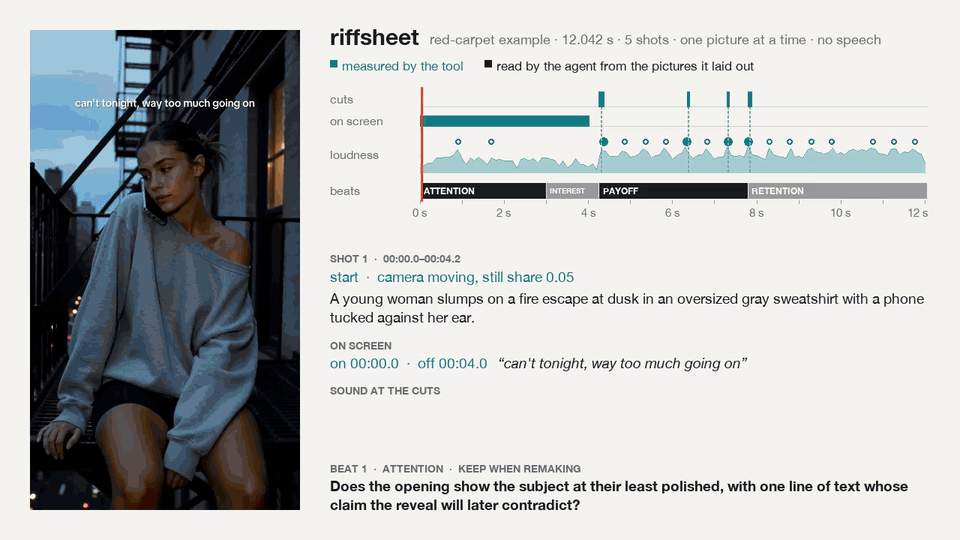
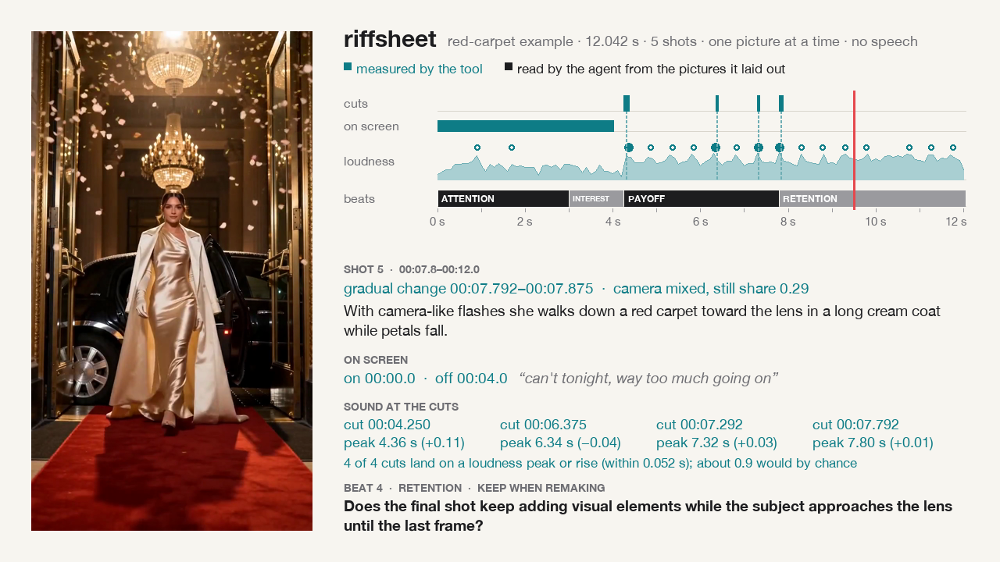
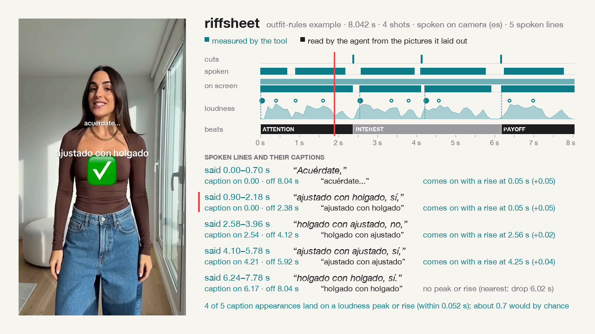
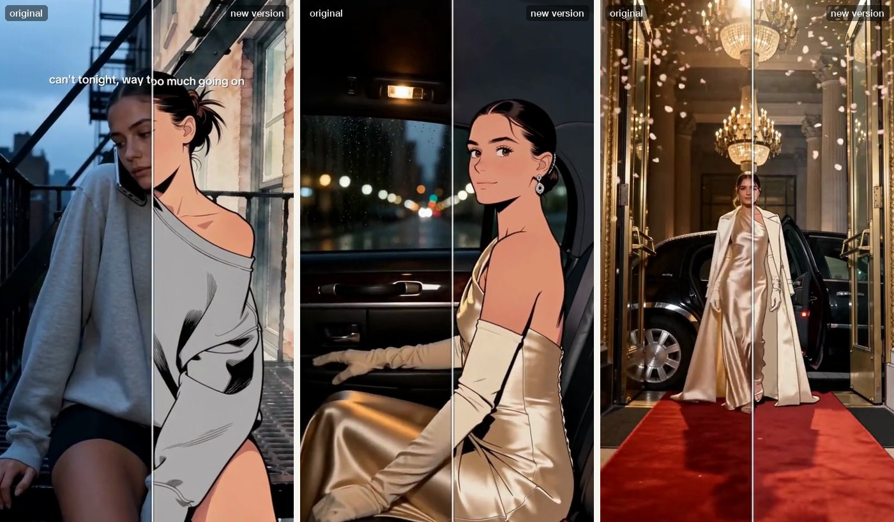
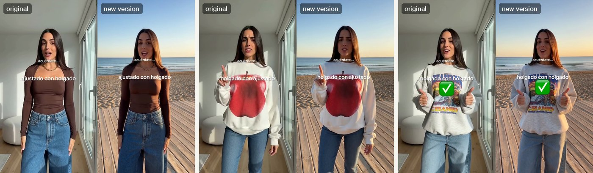
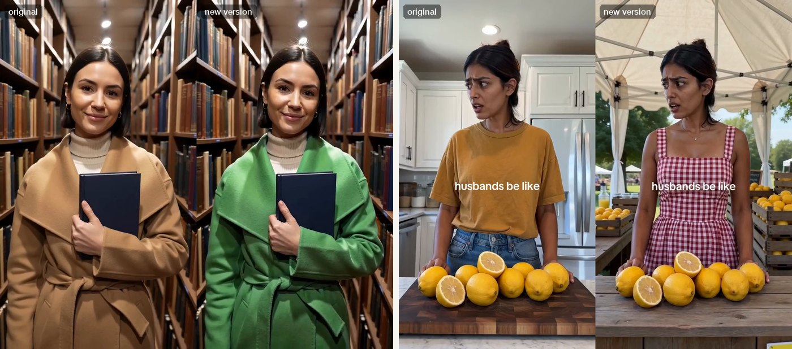

<h1 align="center">riffsheet</h1>

<p align="center"><b>给编程 agent 用的视频拆解工具：在你自己的电脑上，让 agent 把一条短视频逐镜头拆开。</b><br>
剪辑点、字幕的出现与消失时间、响度和每个词的时间都是测出来的；其余部分由 agent 看工具排好的图来判断。<br>
你得到一份 riffsheet：视频里发生了什么、为什么能留住观众，以及你复刻自己的版本时必须保留什么。</p>

<p align="center">
<a href="#安装">安装</a> · <a href="#示例">示例</a> · <a href="EVAL.md">准确度</a> · <a href="#它做不到什么">局限</a> · <a href="README.md">English</a>
</p>

<p align="center">免费，MIT 许可，用 Python 和 ffmpeg 离线运行。是一个 agent 技能（skill），适用于 Claude Code、Codex 以及其他能执行命令、能看图片的 agent。<br>
<sub>由 <a href="https://riffkit.ai/?utm_source=riffsheet&utm_medium=github&utm_campaign=riffsheet&utm_content=zh_readme_maker">Riffkit</a> 制作。riffsheet 不需要账号，也不向我们发送任何东西。</sub></p>

<p align="center"><picture><source media="(prefers-reduced-motion: reduce)" srcset="docs/media/hero_still.png"></picture></p>
<p align="center"><sub>我们自己的一条视频，由 riffsheet 拆解。完整结果见 <a href="examples/red-carpet/">examples/red-carpet</a>。</sub></p>

> 本页译自 [README.md](README.md)；两者不一致时以英文版为准。仓库里的其他文档（评测、示例说明、方法和工具手册、更新记录）目前只有英文，riffsheet 生成的结果也是英文的。

## 安装

需要 ffmpeg 7 或更新版本，以及 Python 3.9 或更新版本。要识别说出的话，还需要可选的 `faster-whisper` 包（见[环境要求](#环境要求)）。

**1. 直接告诉你的 agent**（Claude Code、Codex，或任何能执行命令的 agent）：

```text
安装 https://github.com/riffkit/riffsheet 这个 riffsheet 技能，然后逐镜头拆解 ~/Downloads/clip.mp4
```

**2. 或者用 git 放进 agent 的技能文件夹：**

```bash
git clone https://github.com/riffkit/riffsheet ~/.claude/skills/riffsheet   # Claude Code
git clone https://github.com/riffkit/riffsheet ~/.agents/skills/riffsheet   # Codex
```

在 Claude Code 里也可以作为插件添加：`claude plugin marketplace add riffkit/riffsheet`，然后 `claude plugin install riffsheet@riffsheet`。其他 agent：把文件夹放在任意位置，然后对它说「Read SKILL.md in the riffsheet folder and follow it.」

**3. 或者用 skills 命令行工具**（需要 Node）：`npx skills add riffkit/riffsheet`

## 试一试

把一个视频文件交给你的 agent，用你自己的话提要求：

```text
逐镜头拆解这条视频：~/Downloads/ad.mp4
这条 TikTok 为什么能火？我想做一条自己的版本。
分析这条 Reel，把每条字幕和它出现的时间列出来。
```

大约 4 到 8 分钟后，你会得到供人阅读的 `riffsheet.md`，以及包含全部数值的 `riffsheet.json`。下面是其中一个示例的开头，一条 8 秒、用西班牙语说话的视频（结果原文是英文）（结果是英文的，以下原样引用）：

> **8.042 s · 4 shots · one picture at a time · spoken on camera (es) · 5 spoken lines**
>
> Sound and picture (measured times, not what the sound is): 0 of 3 cuts land on a loudness peak or rise (within 0.052 s); about 0.4 would by chance, with 11 peaks and rises in 8.0 s; 4 of 5 caption appearances land on a loudness peak or rise (within 0.052 s); about 0.7 would by chance, with 11 peaks and rises in 8.0 s.
>
> **00:02.4–00:04.1** At 00:02.375 a hard cut (checked on frames: no motion blur, nothing covering the lens, no blended, faded or white frame between) changes her clothes while the static, locked eye-level medium-wide framing and the place hold … She now wears an oversized white crew-neck sweatshirt printed with one large photographic red apple across the front over mid-blue skinny jeans. … The main person says on camera at a measured pace, frowning with the finger raised, “holgado con ajustado, no,”.
>
> **Keep when remaking.** Does each outfit change at a cut together with its rule label, and does at least one verdict break the run of approvals with a visibly different reaction?

## 示例

两次首跑：完全没见过这个项目的编程 agent，分析我们自己的视频。每个示例都附有 agent 用到的图片、它执行过的命令，以及它没有把握的地方。agent 写下的内容一字未改。

| | |
|---|---|
| <a href="examples/red-carpet/"></a> | <a href="examples/outfit-rules/"></a> |
| **[red-carpet](examples/red-carpet/)**：12 秒，按音乐剪辑，没有人说话。语音识别在音乐里听出了一句话；agent 逐帧检查了她的嘴，没有写任何台词。工具把 4 处变化算作剪辑点（一处淡入、一处硬切、两处闪白帧），这 4 处全部落在响度峰值或上升处，而随机情况下约为 0.9 个。 | **[outfit-rules](examples/outfit-rules/)**：8 秒，对着镜头说西班牙语，带字幕。4 个镜头，5 句台词。3 个剪辑点中有 0 个落在响度峰值或上升处，但 5 次字幕出现中有 4 次落在上面。 |

## 你会得到什么

每条视频两个文件：

- `riffsheet.md`：写给人读的视频说明。先讲发生了什么、为什么能留住观众，再按顺序讲每个节拍：画面上有什么、说了什么、这个节拍对观众起什么作用，以及复刻时必须保留什么。
- `riffsheet.json`：完整数据。每句台词及其时间和语速；每条字幕的文字、时间、位置、大小和颜色；每个图形元素的框和时间；人物和物体；每一段带时间码的描述；声音事件落在剪辑点和字幕出现处的情况；以及每个值的来源。格式见 [`schema/riffsheet.schema.json`](schema/riffsheet.schema.json)。

上面引用的那句台词在 `riffsheet.json` 里的样子，包括 agent 对一个听错的词所做的更正：

```json
{"id": "vs3", "time_range": [2.58, 3.96], "text": "holgado con ajustado, no,",
 "mode": "on_camera_dialogue", "speaker": "protagonist",
 "_src": {"time_range": "measured", "text": "measured"},
 "_pace": {"unit": "words", "count": 4, "per_s": 2.9, "band": "measured", "longest_gap_s": 0.14,
           "pauses_over_0_4s": [], "trend": null},
 "_notes": ["transcript 'olvado' -> 'holgado' (seen in a word-for-word caption)"]}
```

## 它如何忠于画面

- **能测的就测。** 剪辑点时间、每条字幕出现的那一帧和消失的那一帧、镜头是否固定，都从画面帧测得；响度、每个词的时间和每句话的语速，从声音测得。
- **每个值都注明来源：** 工具测得、agent 看到、推断、不确定，或未判断。证据不足以确定一个测量值时，工具不给出这个值，并说明原因。
- **每个细节都指向那一刻的近景。** 关于人物穿戴和手持物、产品或场景的每句描述，都必须指明一张拍到那一刻的大图，否则就要标为不确定；在此之前工具不会生成 riffsheet。工具检查这张图存在、并且拍的是那一刻；文字与图是否相符，由 agent 负责核对。
- **说清楚它判断不了什么。** 语气、放的是哪类音乐，以及画面和测量都无法确定的其他内容，都列为未判断。
- **除了 ffmpeg 不用装别的。** 纯 Python，只用标准库。不需要下载模型；语音识别是可选的。
- **解释视频为什么有效。** 逐个节拍说明每一部分对观众起什么作用，并给出复刻时要保住它必须通过的一项检验。

agent 遵循的流程见 [`references/METHOD.md`](references/METHOD.md)；每条命令的说明见 [`references/TOOL.md`](references/TOOL.md)。

## 准确度

两项测试，于 2026-11-27 在本次发布之前的开发版本上进行（细节和方法见 [EVAL.md](EVAL.md)）：

| 测量项 | 结果 |
|---|---|
| 十条视频（8 到 45 秒；英语、中文、韩语）里的陈述，由另一个 agent 逐条对照画面帧核查 | 649 条正确，23 条错误，17 处遗漏 |
| 硬切，检查剪辑点的六条视频 | 25 个中找到 24 个，没有误报 |
| 字幕出现与消失时间，两条有逐帧标准答案的视频 | 精确到帧 |
| 一条 10.6 秒、从未参与开发的视频，对照事先从画面帧列出的 137 条事实打分 | 64 条完全说对，36 条部分说对，没有一条说反 |

在本次发布的代码上重新测量：剪辑点检测在这六条视频上仍然找到 25 个硬切中的 24 个，没有误报；在一条 45 秒、同一机位内有 9 处跳切的口播视频上，找到 7 处。陈述的统计没有重新测量。核查用的 agent 与写作的 agent 是同一类模型，声音没有打分，十条视频是很小的样本。

## 它做不到什么

- **听。** 它测量响度、词的时间，以及声音事件落在剪辑点和字幕出现处的情况，但说不出那是什么声音：音乐、语气和音效都标为未判断。没人说话时语音识别也可能返回文字；agent 会检查嘴型并把它们放到一边（见 red-carpet 示例）。
- **自己读文字。** 工具找出字幕以及字幕何时变化；文字由 agent 从图片上读出。字幕样式测不出来时，agent 给出自己的判断并注明。
- **抓到每一处剪辑。** 同一机位内的跳切，要在一帧之内有十分之一以上的画面变化、且颜色保持一致才会被找到：在一条 45 秒的口播视频上找到 9 处中的 7 处。更小的跳切会提示 agent 判断，或者找不到；在同一背景上淡入另一套衣服、另一个人或另一个物体检测不到；缓慢的叠化可能漏掉。全部已知局限见 [`references/TOOL.md`](references/TOOL.md)。
- **处理好长视频。** 它为一分钟以内的片段设计，在 8 到 45 秒的片段上测试过。更长的视频照样能跑，但总览图的间隔会拉大；超过三分钟时，工具会提示哪些步骤会慢。
- **从链接下载视频。** 请给它视频文件。
- **用你的语言写结果。** 不管你用什么语言提要求，riffsheet 的内容都是英文的。视频本身可以是任何语言：台词和画面上的字照原样保留。

## 时间和成本

工具本身处理一条短片只要几秒钟，大部分时间花在 agent 上：在本次发布的代码上做的五次首跑（8 到 45 秒，包括这两个示例），每次都在没有人帮助的情况下用大约 4 到 8 分钟完成；两个示例各用了大约 40 条命令、打开大约 20 张图片。这几次没有逐条给陈述打分。agent 的用量主要来自它打开的图片和步骤数，所以流程会把命令和图片合并成尽量少的步骤；工具还会打印每张图片的尺寸和估计的 token 数。

## 从 riffsheet 到你自己的版本

riffsheet 告诉你每个节拍起什么作用、你的版本必须保留什么。字幕、卡片、图形、节奏和剪辑，都可以根据测得的时间、框和颜色，用代码（ffmpeg、脚本）或视频编辑软件重建。人物、场景和产品的画面却不行：它需要摄像机，或者视频模型。

[Riffkit](https://riffkit.ai/?utm_source=riffsheet&utm_medium=github&utm_campaign=riffsheet&utm_content=zh_readme_footage) 根据你的原视频生成这些画面，可以免费开始。Swap（替换）保留镜头，换掉镜头里的人或物；Adapt（改编）保留视频有效的地方，讲一个新故事。Riffkit 自己的技能会告诉 agent 如何配合 riffsheet 使用它。

两个示例用 Swap 复刻后的样子：

| | |
|---|---|
|  |  |
| [red-carpet](examples/red-carpet/) 的手绘动画版。这个版本我们只有对比图，因此不对它做任何测量上的说法。 | [outfit-rules](examples/outfit-rules/) 搬到海滨木栈道上。用 riffsheet 测量：3 个剪辑点中有 2 个、10 个字幕出现与消失时间中有 7 个与原片落在同一帧，其余相差不超过两帧（[对照表](examples/outfit-rules/#from-the-sheet-to-your-own-version)）。 |

Swap 还能换的其他东西，例如外套的颜色，或者同时换衣服和场景：

<p align="center"></p>

## 隐私

一切都在你的电脑上运行：视频、图片和结果都留在你选定的文件夹里。唯一的联网操作是下载语音模型，而且只在你用 `--download` 要求时才会发生。你的编程 agent 向它自己的模型服务商发送什么，由那个 agent 决定。

## 常见问题

**能离线用吗？** 能。下载完可选的语音模型之后，没有任何操作需要联网。

**支持哪些 agent？** 任何能执行 shell 命令、能打开图片的 agent：Claude Code 和 Codex 会把它识别为技能；其他 agent 可以让它去读 `SKILL.md`。

**能直接给链接吗？** 不能。请自己下载视频，把文件交给 agent。

**能用它把一条视频原样搬运吗？** 它的用途正好相反：它告诉你一条视频为什么有效、每个节拍做了什么，让你用自己的人物、产品和故事做出你自己的版本，而不是一个复制品。

**riffsheet 是谁做的？** Riffkit 团队。Riffkit 是一项付费服务，可以免费开始，它根据你给的视频生成新的视频画面。riffsheet 与它相互独立：在你的电脑上运行，不需要账号，也不向我们发送任何东西。MIT 许可允许你把它用于任何用途。

## 环境要求

- ffmpeg 和 ffprobe，版本 7 或更新，放在 `PATH` 上（macOS 上用 `brew install ffmpeg`，Linux 上用你的包管理器）。
- Python 3.9 或更新版本。工具本身只用标准库。
- 识别说出的话（可选）：`faster-whisper` 包，`python3 -m pip install faster-whisper`，以及它的语音模型。工具使用 `small` 模型，从不自行下载：第一次使用时，给 `transcribe` 加上 `--download`（约 500 MB，存在通常的 Hugging Face 缓存里）。没有语音识别时，分析照样覆盖所有画面内容，你也可以提供用其他方式做的、同样格式的转写。如果把 faster-whisper 装在虚拟环境里，每条命令都要用那个环境的 Python 运行；`SKILL.md` 里写了做法。

检查安装：进入仓库文件夹，运行 `python3 -I scripts/riffsheet.py --version`；测试用 `python3 -B -m unittest` 运行（测试会用 ffmpeg 自己生成测试片段）。

## 参与贡献与许可

读错的内容和 bug 请提到 [Issues](../../issues/new/choose)：有一个模板用于报告 riffsheet 里某句话错了，另一个用于报告 bug 或安装问题。如何运行测试、修改需要遵守的规则见 [CONTRIBUTING.md](CONTRIBUTING.md)；改动记录见 [CHANGELOG.md](CHANGELOG.md)。

MIT。见 [`LICENSE`](LICENSE)。
