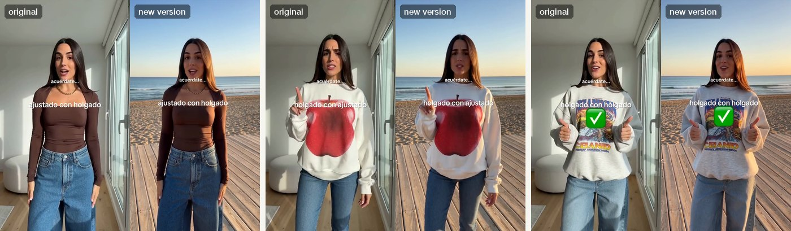

# Example: outfit rules (8 seconds, Spanish, spoken to camera)

A video of ours: a young woman faces the camera in a sunny white room and, in four quick shots, one outfit per shot, says in Spanish which combinations of fitted and loose pieces work, with each rule written as a caption. Watch it at https://riffkit.ai/showcase/riff-3-v2.mp4 (not included here).

## How this result was made

A coding agent that had never seen the project followed `SKILL.md` with the code in this repository, starting from the video file alone. It took about 6 minutes, 41 commands and 20 images opened. Nothing it wrote was edited.

The agent ran on a file called `video.mp4`, and the report's heading is taken from the file name. The result here was rebuilt from the same video named `outfit-rules.mp4`, by replaying its commands in order (`commands.txt`) with its judgment file unchanged (`judgment.json`). The rebuilt `riffsheet.md` and `riffsheet.json` were identical to the agent's except for the heading. With riffsheet 0.2.0, `riffsheet.md` also says near its top that the sound was not judged (no hearing check was taken in that run) and lists, in a section of its own, what the agent recorded as missing from the tool; `riffsheet.json` records how each optional stage ran and that no hearing check was taken. In `commands.txt`, `rs` stands for the tool as `SKILL.md` defines it, and folders are written relative to the video's folder.

| file | what it is |
|---|---|
| `riffsheet.md` | the account a person reads, beat by beat |
| `riffsheet.json` | the complete data, with where each value came from |
| `judgment.json` | what the agent wrote: its reading of the pictures |
| `commands.txt` | every command the agent ran, in order |
| `pictures/` | four of the pictures it worked from (below) |

Look first at:

1. `riffsheet.md`.
2. [pictures/overview_01.jpg](pictures/overview_01.jpg): the first overview sheet, one cell every half second, with the words spoken in each.
3. [pictures/cap.jpg](pictures/cap.jpg): each state of the rule caption, with measured on and off times.
4. [pictures/zoom_3.21_10-05-90-75.jpg](pictures/zoom_3.21_10-05-90-75.jpg) and [pictures/zoom_7.00_10-05-90-75.jpg](pictures/zoom_7.00_10-05-90-75.jpg): close views the clothing was checked on.
5. [pictures/mouth_-0.15_7.93_38-17-66-30.jpg](pictures/mouth_-0.15_7.93_38-17-66-30.jpg): her mouth at each word, the check that she is the one speaking.

## What the agent was unsure of, and what went wrong on the way

- Its first `build` failed: it had read `"to": "S1"` in the judgment file as "through shot 1", where it means the start of shot 1. It corrected the file and built again.
- The tool warned that the jeans were called both blue and red. That was a false alarm: the red was the apple printed on the sweatshirt, measured in the same shot as the blue jeans.
- The caption's style (color, size, position) was not measured: no state of the caption kept a measured style. The agent read it off close views and says so in each caption's `why`.
- The lettering on the last sweatshirt is marked uncertain: it is only partly legible.
- Speech recognition heard "holgado" (loose) as "olado" and "olvado"; the agent corrected the words from the captions.
- Sound and picture, as measured: 0 of 3 cuts land on a loudness peak or rise, but 4 of 5 caption appearances do, against about 0.7 expected by chance. The tool measures when sound events happen, not what they are.

## From the sheet to your own version

A version of this video on a beach boardwalk was made with [Riffkit](https://riffkit.ai/?utm_source=riffsheet&utm_medium=github&utm_campaign=riffsheet&utm_content=example_readme) Swap: the same shots, with the place changed.

We ran riffsheet's measuring commands on that version (`scan`, then `text` with the agent's two caption boxes) and set its times next to the original's. Both are 8.042 s at 24 frames per second; one frame is 0.042 s. The version we measured is at half resolution and has no sound.

| measured | original | Swap version |
|---|---|---|
| cuts | 2.375, 4.125, 6.167 | 2.375, 4.167, 6.167 |
| header "acuérdate..." | 0.000–8.042 | 0.000–8.042 |
| "ajustado con holgado" | 0.000–2.375 | 0.000–2.292 |
| "holgado con ajustado" | 2.542–4.125 | 2.542–4.167 |
| "ajustado con ajustado" | 4.208–5.917 | 4.250–5.917 |
| "holgado con holgado" | 6.167–8.042 | 6.167–8.042 |

Caption times are on and off: the first frame showing it and the first frame not showing it. Two of the three cuts, and 7 of the 10 caption on and off times, fall on the same frame in both. The second cut comes one frame later in the new version, and the second caption leaves with it; the first caption leaves two frames before the first cut instead of with it; the third caption appears one frame later.
