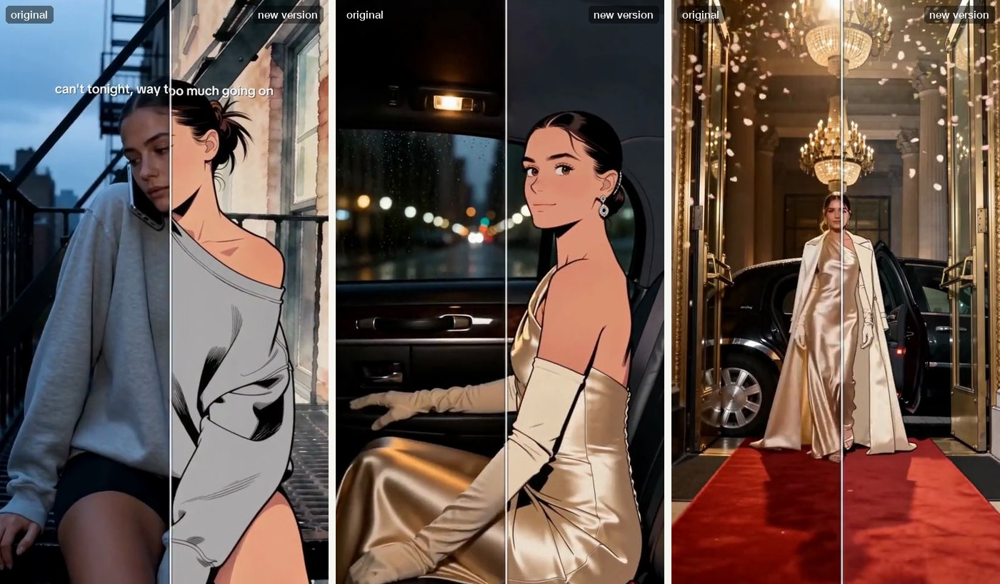

# Example: red carpet (12 seconds, edited to music, nobody speaks)

A video of ours: a young woman slumps on a fire escape at dusk under the caption "can't tonight, way too much going on", kicks her sneaker into the lens, and the picture fades into a car at night, then a red-carpet arrival at a hotel. Watch it at https://riffkit.ai/showcase/hero-center-v2.mp4 (not included here).

## How this result was made

A coding agent that had never seen the project followed `SKILL.md` with the code in this repository, starting from the video file alone. It took about 6 to 7 minutes, 38 commands and 21 images opened. Nothing it wrote was edited.

The agent ran on a file called `video.mp4`, and the report's heading is taken from the file name. The result here was rebuilt from the same video named `red-carpet.mp4`, by replaying its commands in order (`commands.txt`) with its judgment file unchanged (`judgment.json`). The rebuilt `riffsheet.md` and `riffsheet.json` were identical to the agent's except for the heading. Since then one line of `riffsheet.md` has changed with a fix to the tool: the line under the heading said "no speech (en)", as if the speech were in English; it now says "no speech · on-screen text in en". In `commands.txt`, `rs` stands for the tool as `SKILL.md` defines it, and folders are written relative to the video's folder.

| file | what it is |
|---|---|
| `riffsheet.md` | the account a person reads, beat by beat |
| `riffsheet.json` | the complete data, with where each value came from |
| `judgment.json` | what the agent wrote: its reading of the pictures |
| `commands.txt` | every command the agent ran, in order |
| `pictures/` | five of the pictures it worked from (below) |

Look first at:

1. `riffsheet.md`.
2. `pictures/overview_01.jpg`: the first overview sheet, one cell every half second.
3. `pictures/top_caption.jpg`: the caption, with its measured on and off times.
4. `pictures/frames_3.25_4.50_01.jpg`: consecutive frames of the kick into the lens (the first of two pages).
5. `pictures/mouth_5.90_6.37_50-28-78-44.jpg`: her mouth at every frame while speech recognition reports words.
6. `pictures/zoom_5.00_00-00-100-75.jpg`: a close view the dress and gloves were checked on.

## What the agent was unsure of, and what went wrong on the way

- Nobody speaks, but speech recognition returned a short Korean phrase. The agent checked her mouth frame by frame (closed), listed the phrase as words in the music with its reasons, and wrote no spoken lines. Whether it is a sung lyric, a voice in the track or a misrecognition is listed as not judged.
- The caption was not found as a fixed layer (the picture behind it moved too little for the test); the agent took its box by eye from the overview and read it with `text`.
- The caption's measured color was wrong: it came from the sky behind the first letters. The agent gave its own reading, white lettering with a faint shadow, and said why in the caption's `why`.
- Two points are left uncertain: whether the woman in the wide shots is the same woman as in the close views, and whether the camera starts to move in the last second.
- Sound and picture, as measured: the tool counts 4 changes as cuts here (the fade out of the white frame, one hard cut, and two flash frames the agent describes as flashes), and all 4 land on a loudness peak or rise, against about 0.9 expected by chance. The tool measures when sound events happen, not what they are.

## From the sheet to your own version

A hand-drawn animation version of this video was made with [Riffkit](https://riffkit.ai/?utm_source=riffsheet&utm_medium=github&utm_campaign=riffsheet&utm_content=example_readme) Swap. We have it only as a comparison picture, so we make no measured claim about it.

